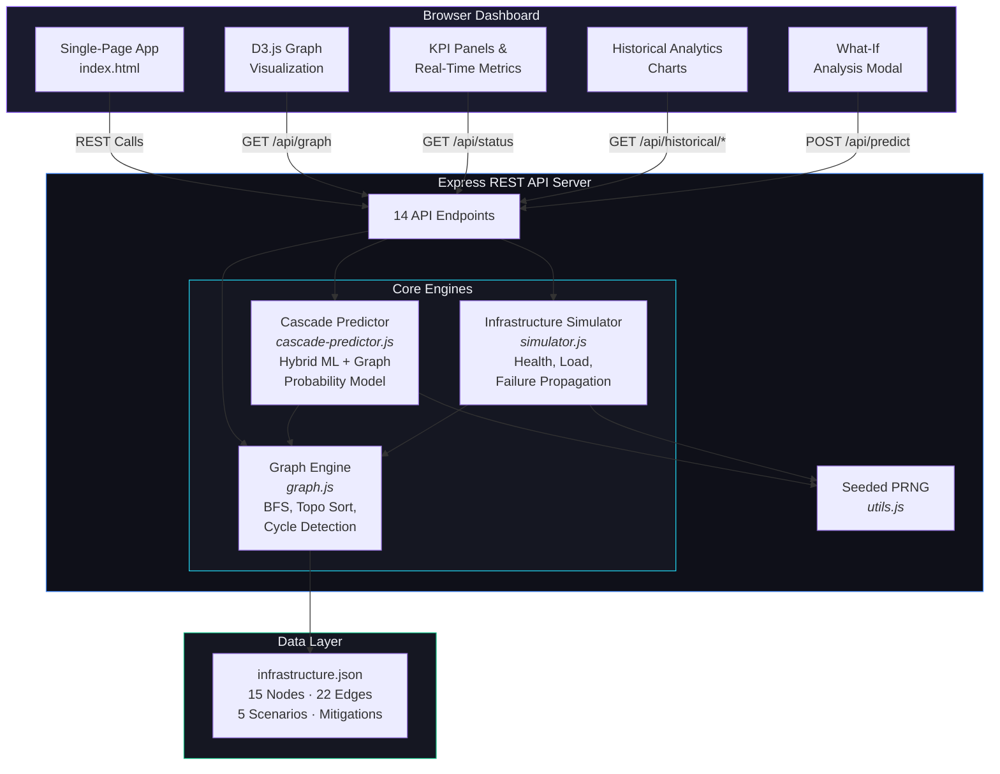
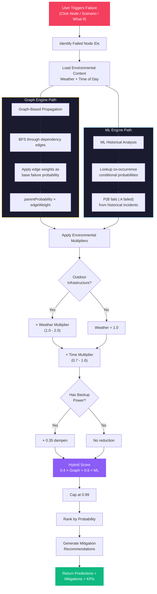
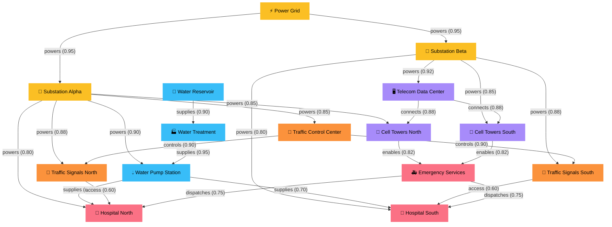

# PURPLE — Round 2 Submission

## 1. Team Name
Purple Team 10


## 2. Problem Statement & Solution Description

**Problem Statement:**

Urban infrastructure systems (power grids, water supply, telecom networks, traffic management, hospitals) are deeply interconnected. When one component fails, failures cascade unpredictably through dependencies — a single substation outage can knock out cell towers, disable traffic signals, cut hospital power, and paralyze emergency services. City operators lack tools to predict these cascades before they happen or to prioritize mitigation in real time.

**Proposed Solution:**

**InfraPulse** — a cascade failure prediction system that models city infrastructure as a directed dependency graph and uses a hybrid ML + graph-based engine to predict how failures propagate. The system:

- Maps 15 infrastructure nodes across 5 categories (electricity, water, telecom, roads, emergency) connected by 22 weighted dependency edges
- Predicts cascade failures using a hybrid model: 40% graph-based propagation analysis + 60% historical co-occurrence probabilities trained from incident data
- Factors in environmental context — weather conditions (storm = +70% failure risk, flood = +100%) and time-of-day (evening peak = +60%)
- Accounts for backup power systems at hospitals, data centers, and emergency services
- Recommends ranked mitigation actions (isolate, reroute, load shed, activate backups) scored by effectiveness and economic impact
- Provides real-time simulation with live health/load monitoring and interactive D3.js graph visualization


## 3. Selected Features

### Feature 1: Cascade Failure Prediction Engine

A hybrid probabilistic prediction engine that combines dependency graph traversal with ML-based historical analysis to predict infrastructure cascade failures.

**How it works:**
1. BFS traversal from failed nodes through weighted dependency edges calculates graph-based failure probabilities
2. A conditional probability model trained from ~97 historical incidents provides co-occurrence-based predictions
3. The hybrid score combines both: `0.4 × graphProbability + 0.6 × historicalProbability`
4. Environmental multipliers adjust predictions — weather (clear/rain/storm/heat/flood) and time period (night/morning peak/midday/evening peak)
5. Backup power dampening reduces probability by 60-65% for equipped nodes

The engine outputs per-node failure probability, cascade depth, estimated time-to-impact, population affected (deduplicated by zone, capped at 2.1M), projected revenue loss, and ranked mitigation recommendations.

### Feature 2: Interactive Real-Time Dashboard with What-If Analysis

A single-page dashboard providing real-time infrastructure monitoring, interactive failure simulation, and historical analytics.

**Components:**
- **Live D3.js Dependency Graph** — Interactive force-directed visualization where clicking any node triggers failure simulation. Nodes color-code by risk level, edges highlight cascade paths. Drag to rearrange, scroll to zoom.
- **KPI Dashboard** — Real-time metrics: online service count, risk level, population at risk, cascade depth, revenue at risk per hour, estimated recovery time
- **What-If Modal** — Select multiple infrastructure components to fail simultaneously and analyze the combined cascade
- **Mitigation Panel** — Prioritized response actions with effectiveness ratings, deployment times, and estimated savings
- **Historical Analytics** — Category breakdown charts, severity distribution donut, monthly trend stacked bars, and hour-vs-day failure heatmap built with D3.js


## 4. Setup & Running Instructions

**Prerequisites:** Node.js 18 or higher

```bash
# 1. Clone the repository
git clone https://github.com/Tech-Forge74/purple_team_10.git
cd purple_team_10

# 2. Install dependencies
npm install

# 3. Start the server
npm start
```

The server starts at **http://localhost:3000**. Open this URL in a browser to access the dashboard.

**Dependencies:** Express 4.x (server), Helmet (security headers), CORS — all installed automatically via `npm install`.


## 5. Feature Demonstration

### Feature 1: Cascade Failure Prediction Engine

1. Open **http://localhost:3000** and you will see the Live Monitor tab with an interactive infrastructure dependency graph.
2. **Click the "Power Grid" node** (yellow lightning bolt icon at the top of the graph) to trigger a power grid failure.
3. Watch the graph update in real time — nodes turn red (critical), orange (high risk), or blue (medium risk) based on predicted failure probability. Cascade edges highlight in red.
4. The **Cascade Predictions** panel on the right shows each affected service with:
   - Failure probability percentage with color-coded risk bar
   - Cascade depth (how many hops from the trigger)
   - Population affected and revenue impact per hour
5. Change the **weather condition** to "Storm (+70%)" in the top navbar dropdown and observe how all probabilities increase.
6. Change the **time period** to "Evening Rush" to see peak-hour risk amplification.
7. The **Mitigation Actions** panel shows ranked recommendations — e.g., "Emergency Load Shedding" for the power grid with effectiveness rating and estimated savings.
8. Click **Restore** to reset all systems, then try the pre-built **Scenarios** on the right sidebar (e.g., "Urban Flooding" triggers 3 simultaneous failures).

**Expected outcome:** The prediction engine shows which downstream services are at risk, with probabilities ranging from 10-99%, mitigation options ranked by priority, and real-time KPI updates showing total population at risk and revenue impact.

### Feature 2: Interactive Real-Time Dashboard with What-If Analysis

1. From the Live Monitor tab, click the **What-If** button in the top-right navbar.
2. A modal opens showing all 15 infrastructure nodes. **Select multiple nodes** — for example, click "Substation Alpha", "Water Treatment Plant", and "Telecom Data Center" (they highlight in red when selected).
3. Click **Run Analysis** to simulate all three failing simultaneously.
4. Observe the combined cascade effect:
   - The dependency graph lights up with widespread failures
   - KPI row updates: population at risk, revenue loss, cascade depth
   - Predictions panel shows the compounding effect of multiple triggers
   - Mitigation actions prioritize the most impactful responses
5. Click **Restore** to reset, then switch to the **Historical Analytics** tab.
6. The analytics tab shows four D3.js visualizations:
   - **Incidents by Category** — Bar chart showing which infrastructure sectors fail most (electricity leads)
   - **Severity Distribution** — Donut chart with critical/high/medium breakdown
   - **Monthly Trend** — Stacked bar chart showing incident patterns over time
   - **Failure Heatmap** — Hour-of-day vs day-of-week grid showing when failures cluster

**Expected outcome:** The What-If analysis demonstrates compounding cascade effects from simultaneous failures, with the dashboard updating all panels in real time. Historical analytics reveal patterns — electricity failures are most frequent, and failures cluster during peak hours.


## 6. Architecture Diagram



## 7. Cascade Prediction Flow



## 8. Infrastructure Dependency Graph



## 9. Project Structure

```
├── data/
│   └── infrastructure.json   # 15 nodes, 22 edges, 5 scenarios, mitigation options
├── public/
│   └── index.html            # Single-page dashboard (D3.js + vanilla JS)
├── src/
│   ├── server.js             # Express REST API (14 endpoints)
│   ├── graph.js              # Directed dependency graph engine (BFS, topological sort, cycle detection)
│   ├── cascade-predictor.js  # Hybrid ML + graph cascade prediction with environmental context
│   ├── simulator.js          # Real-time infrastructure state simulation (health, load, failures)
│   └── utils.js              # Seeded PRNG for reproducible simulations
└── package.json
```

**Tech Stack:** Node.js, Express, D3.js 7.8, Helmet, CORS
