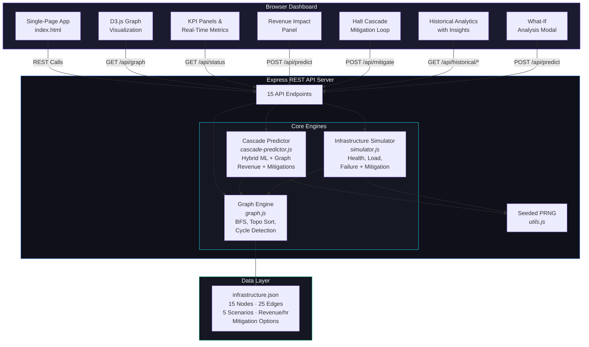
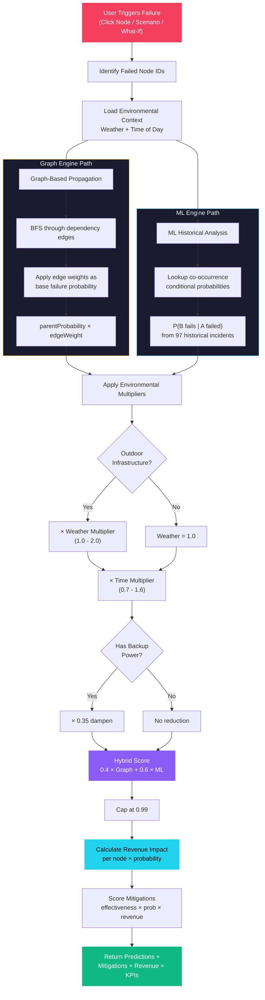
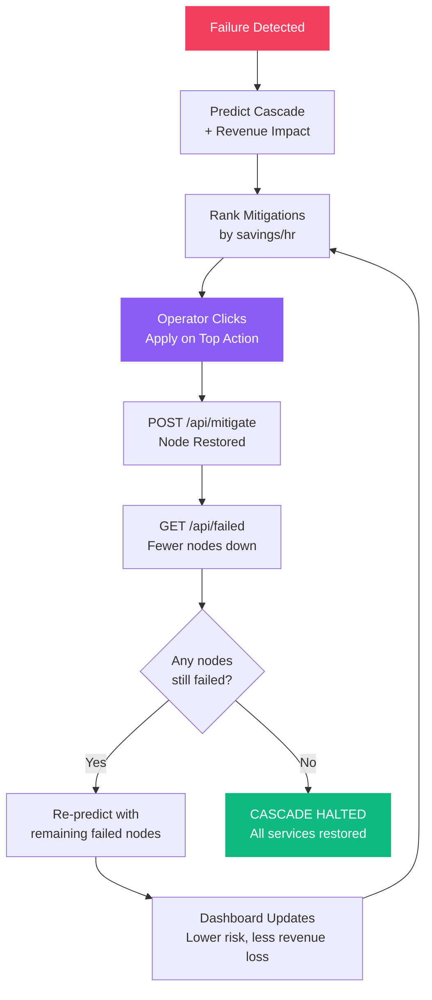
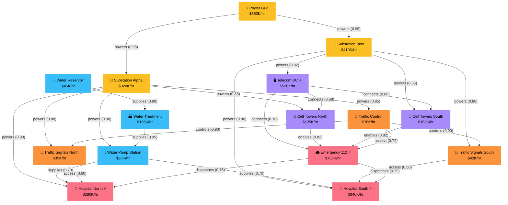

# PURPLE — Round 2 Submission

## 1. Team Name
Purple Team 10


## 2. Problem Statement & Solution Description

**Problem Statement:**

Urban infrastructure systems (power grids, water supply, telecom networks, traffic management, hospitals) are deeply interconnected. When one component fails, failures cascade unpredictably through dependencies — a single substation outage can knock out cell towers, disable traffic signals, cut hospital power, and paralyze emergency services. City operators lack tools to predict these cascades before they happen or to prioritize mitigation in real time.

**Proposed Solution:**

**InfraPulse** — a cascade failure prediction system that models city infrastructure as a directed dependency graph and uses a hybrid ML + graph-based engine to predict how failures propagate. The system:

- Maps 15 infrastructure nodes across 5 categories (electricity, water, telecom, roads, emergency) connected by 25 weighted dependency edges
- Predicts cascade failures using a hybrid model: 40% graph-based propagation analysis + 60% historical co-occurrence probabilities trained from 97 incident records
- Factors in environmental context — weather conditions (storm = +70% failure risk, flood = +100%) and time-of-day (evening peak = +60%)
- Accounts for backup power systems at hospitals, data centers, and emergency services (reduces cascade probability by 60-65%)
- Calculates real-time revenue impact per hour of downtime for each affected service
- Recommends ranked mitigation actions (isolate, reroute, load shed, activate backups) with **executable "Apply" buttons** that halt the cascade progressively
- Provides real-time simulation with live health/load monitoring and interactive D3.js graph visualization


## 3. Selected Features

### Feature 1: Cascade Failure Prediction Engine with Revenue Impact

A hybrid probabilistic prediction engine that combines dependency graph traversal with ML-based historical analysis to predict infrastructure cascade failures and their financial impact.

**How it works:**
1. BFS traversal from failed nodes through weighted dependency edges calculates graph-based failure probabilities (threshold: 0.05 for deeper cascade paths)
2. A conditional probability model trained from ~97 historical incidents provides co-occurrence-based predictions
3. The hybrid score combines both: `0.4 × graphProbability + 0.6 × historicalProbability`
4. Environmental multipliers adjust predictions — weather (clear/rain/storm/heat/flood) and time period (night/morning peak/midday/evening peak)
5. Backup power dampening reduces probability by 60-65% for equipped nodes (hospitals, telecom data center, emergency services)
6. Revenue impact is calculated per affected node weighted by failure probability — showing per-hour, 4-hour, and 24-hour projected losses
7. Mitigation engine scores each action by `effectiveness × probability × (revenue / 100K)` and ranks by estimated savings

**Output per prediction:** Failure probability, cascade depth, time-to-impact, population affected (deduplicated, capped at 2.1M), revenue/hr, risk level, cascade path, and backup power status.

### Feature 2: Halt Cascade — Interactive Mitigation Loop

An actionable mitigation system where operators can **progressively stop a cascading failure** by applying recommended actions one at a time and seeing the cascade shrink in real-time.

**How it works:**
1. When a failure occurs, the system recommends 6-8 prioritized mitigation actions (sorted by estimated revenue saved per hour)
2. Each mitigation has an **"Apply" button** that calls the server to execute it — the affected node is restored to operational status
3. After applying, the system **re-fetches the actual failed nodes** (now fewer) and **re-runs prediction** with only those still down
4. The dashboard updates in real-time: cascade predictions shrink, revenue at risk drops, population impact decreases
5. Operators repeat until all cascading effects are contained
6. A savings banner tracks total mitigations applied and cumulative revenue saved

**This is not just a display — it's a control loop.** Each "Apply" click changes the system state and the prediction updates to reflect the new reality.

### Feature 3: Interactive Real-Time Dashboard with What-If Analysis & Historical Analytics

A single-page dashboard providing real-time infrastructure monitoring, interactive failure simulation, and self-explanatory historical analytics.

**Components:**
- **Live D3.js Dependency Graph** — Interactive force-directed visualization where clicking any node triggers failure simulation. Nodes color-code by risk level, edges highlight cascade paths. Drag to rearrange, scroll to zoom.
- **6 KPI Cards** — Online count, risk level, population at risk, cascade depth, revenue at risk/hr (with 4h projection), estimated recovery time
- **Revenue Impact Panel** — Per-hour, 4-hour, and 24-hour projected financial losses with per-service breakdown
- **What-If Modal** — Select multiple infrastructure components to fail simultaneously and analyze the combined cascade with revenue displayed per node
- **Halt Cascade Panel** — Executable mitigation actions with Apply buttons, savings tracker, and progressive cascade reduction
- **Historical Analytics** (separate tab) with:
  - Key Insight banner auto-generating analysis from the data
  - Category bar chart with footer explaining which sector to invest in
  - Severity donut chart showing critical/high/medium distribution
  - Monthly trend chart detecting improving/worsening patterns
  - Failure heatmap with interactive tooltips and staffing recommendations
  - Top Failure Triggers ranking table with frequency bars and severity badges


## 4. Setup & Running Instructions

**Prerequisites:** Node.js 18 or higher

```bash
# 1. Clone the repository
git clone https://github.com/Tech-Forge74/purple_team_10.git
cd purple_team_10

# 2. Install dependencies
npm install

# 3. Start the server
npm start
```

The server starts at **http://localhost:3000**. Open this URL in a browser to access the dashboard.

**Dependencies:** Express 4.x (server), Helmet (security headers), CORS — all installed automatically via `npm install`.


## 5. Feature Demonstration

### Feature 1: Cascade Failure Prediction with Revenue Impact

1. Open **http://localhost:3000** — the Live Monitor tab shows an interactive dependency graph
2. **Click the "Power Grid" node** (yellow lightning bolt) to trigger a failure
3. Watch the graph update — nodes turn red/orange/blue by predicted probability, cascade edges highlight in red
4. The **Cascade Predictions** panel shows each affected service with:
   - Failure probability % with color-coded bar
   - Cascade depth (hops from trigger)
   - Population affected (unique per service: 45K to 2.1M)
   - Revenue impact per hour (unique per service: $35K to $850K/hr)
5. The **Revenue Impact** panel shows:
   - Per-hour total loss (e.g., $3.4M/hr for a power grid failure during a storm)
   - Projected 4-hour and 24-hour losses
   - Per-service breakdown sorted by financial impact
6. Change **weather** to "Storm (+70%)" and **time** to "Evening Rush" — probabilities increase, revenue impact grows
7. Click **Restore** to reset

**Expected output for Power Grid failure (Storm + Evening Rush):**
- 13 services affected, cascade depth 3, population 2.1M
- Revenue at risk: ~$3.4M/hr, ~$13.6M projected 4h loss
- 8 mitigation recommendations available

### Feature 2: Halt Cascade — Stopping the Cascade

1. Trigger a failure (click Power Grid or run a Scenario)
2. The **Halt Cascade** panel shows prioritized actions with **Apply** buttons
3. Click **Apply** on "Emergency Load Shedding" (the top recommendation)
4. Watch what happens:
   - The failed node is restored to operational
   - Failed node count drops (e.g., 4 → 3)
   - Predictions re-run with fewer failed nodes — affected services decrease
   - Revenue at risk drops (e.g., $3.4M/hr → $1.7M/hr — saved $1.7M/hr)
   - A green savings banner appears: "Mitigations applied: 1 — Saving $637K/hr"
5. Apply another mitigation — cascade shrinks further
6. Keep applying until cascade is fully contained
7. Event log shows each mitigation as a green "mitigated" entry

**Expected output for Halt Cascade loop:**
- Before: 4 failed nodes, $1.97M/hr revenue at risk
- After 1 mitigation: 3 failed, $1.56M/hr (saved $410K/hr)
- After 2 mitigations: cascade shrinks further
- Each Apply → fewer failed → lower risk → smaller cascade

### Feature 3: What-If Analysis & Historical Analytics

**What-If:**
1. Click the **What-If** button in the top navbar
2. Select multiple nodes (e.g., "Substation Alpha" + "Water Treatment Plant" + "Telecom Data Center")
3. Each node shows its revenue/hr in the selection modal
4. Click **Run Analysis** — see combined cascade, compounding revenue impact, and recommended mitigations

**Historical Analytics:**
1. Switch to the **Historical Analytics** tab
2. Read the **Key Insight banner** at the top — auto-generated analysis:
   > "Over 12 months, 97 incidents caused $X in revenue losses. Substation Alpha is the #1 root cause with 24 incidents..."
3. Each chart has an **insight footer** explaining what it means:
   - **Incidents by Category**: "Electricity leads with 54 incidents... Action: Prioritize backup power for electricity infrastructure"
   - **Severity Distribution**: "X% of incidents are critical severity — systemic resilience needs improvement"
   - **Monthly Trend**: "Failures are increasing/decreasing over time. Peak month: X. Action: Schedule infrastructure audit"
   - **Failure Heatmap**: Hover any cell to see exact day+hour+count. Footer: "Hotspot: Mon at 14:00 — ensure maximum staffing during peak hours"
4. **Top Failure Triggers** ranking table at the bottom shows every root cause node ranked by frequency with severity badges (C/H/M)


## 6. How It Works — Technical Details

### Prediction Pipeline

```
User triggers failure → BFS graph traversal + ML co-occurrence lookup
→ Apply weather multiplier (1.0–2.0) + time multiplier (0.7–1.6)
→ Apply backup power dampening (×0.35 if equipped)
→ Hybrid score: 0.4 × graph + 0.6 × ML → cap at 0.99
→ Calculate revenue impact per node weighted by probability
→ Score mitigations by effectiveness × probability × revenue
→ Return predictions + mitigations + revenue breakdown + KPIs
```

### Halt Cascade Loop

```
1. Failure occurs → system predicts cascade + recommends mitigations
2. Operator clicks "Apply" on a mitigation
3. Server restores the node (POST /api/mitigate)
4. Frontend fetches updated failed nodes list (GET /api/failed)
5. Frontend re-predicts with only still-failed nodes (POST /api/predict)
6. Dashboard updates: fewer affected services, lower revenue loss
7. Repeat until cascade is fully contained
```

### Environmental Context Multipliers

| Weather    | Multiplier | Time Period   | Multiplier |
|------------|-----------|---------------|-----------|
| Clear      | 1.0×      | Night (0-6)   | 0.7×      |
| Rain       | 1.3×      | Morning Rush  | 1.5×      |
| Storm      | 1.7×      | Midday        | 1.0×      |
| Extreme Heat | 1.4×   | Evening Rush  | 1.6×      |
| Flood      | 2.0×      | Late Evening  | 0.8×      |

### Backup Power Nodes

| Node | Backup Type | Effect |
|------|-------------|--------|
| City Hospital North | Battery + Generator | 60-65% cascade probability reduction |
| City Hospital South | Battery + Generator | 60-65% cascade probability reduction |
| Telecom Data Center | 48-hour diesel generators | 60-65% cascade probability reduction |
| Emergency Services (112) | Satellite comms backup | 60-65% cascade probability reduction |


## 7. API Endpoints

| Method | Endpoint | Description |
|--------|----------|-------------|
| GET | `/api/graph` | Full infrastructure graph (15 nodes, 25 edges) |
| POST | `/api/predict` | Run cascade prediction with weather/time context |
| POST | `/api/mitigate` | **Apply a mitigation action** to halt cascade |
| GET | `/api/risk-assessment` | Risk ranking by downstream impact |
| GET | `/api/status` | Real-time health/load of all nodes |
| GET | `/api/failed` | Currently failed nodes list |
| POST | `/api/simulate/failure` | Trigger a node failure |
| POST | `/api/simulate/restore` | Restore all nodes |
| GET | `/api/events` | Event log (failures, cascades, mitigations) |
| GET | `/api/scenarios` | Pre-built failure scenarios |
| GET | `/api/historical` | Historical incident statistics by trigger |
| GET | `/api/historical/categories` | Incident counts by infrastructure category |
| GET | `/api/historical/timeline` | Monthly incident trend (stacked severity) |
| GET | `/api/historical/heatmap` | Hour × day-of-week failure frequency |
| GET | `/api/context-options` | Available weather and time options |


## 8. Test Cases

### Test 1: Varied Population per Service
**Purpose:** Verify each infrastructure node reports a unique population affected, not a constant value.

```bash
curl -s -X POST http://localhost:3000/api/predict \
  -H 'Content-Type: application/json' \
  -d '{"failedNodes":["power_grid"],"weather":"storm","timeOfDay":18}'
```

**Expected:** 12+ unique population values across predictions (45K, 58K, 75K, 92K, 185K, 230K, 340K, 410K, 425K, 680K, 950K, 2.1M). No two non-related services should show the same population.

### Test 2: Cascade Depth Varies by Trigger Node
**Purpose:** Different trigger nodes produce different cascade depths.

```bash
# Power Grid → depth 3 (grid → substations → downstream → hospitals)
curl -s -X POST http://localhost:3000/api/predict \
  -H 'Content-Type: application/json' \
  -d '{"failedNodes":["power_grid"]}' | node -e "process.stdin.on('data',d=>console.log('Depth:',JSON.parse(d).summary.cascadeDepth))"

# Water Treatment → depth 2 (treatment → pump → hospitals)
curl -s -X POST http://localhost:3000/api/predict \
  -H 'Content-Type: application/json' \
  -d '{"failedNodes":["water_treatment"]}' | node -e "process.stdin.on('data',d=>console.log('Depth:',JSON.parse(d).summary.cascadeDepth))"
```

**Expected:** Power Grid = depth 3, Water Treatment = depth 2. Different triggers produce different depths.

### Test 3: Revenue Impact Calculation
**Purpose:** Revenue data is present, varied, and reflects financial exposure.

```bash
curl -s -X POST http://localhost:3000/api/predict \
  -H 'Content-Type: application/json' \
  -d '{"failedNodes":["power_grid"],"weather":"storm","timeOfDay":18}' \
  | node -e "process.stdin.on('data',d=>{const j=JSON.parse(d);
    console.log('Revenue/hr: $'+j.summary.revenue.perHour);
    console.log('Projected 4h: $'+j.summary.revenue.projected4h);
    console.log('Projected 24h: $'+j.summary.revenue.projected24h);
    j.predictions.forEach(p=>console.log(' ',p.name,'$'+p.revenuePerHour+'/hr'))})"
```

**Expected:** Total ~$3.4M/hr. Per-node values range from $35K/hr (traffic signals) to $850K/hr (power grid). 13 unique revenue values.

### Test 4: Halt Cascade — Mitigation Reduces Failed Nodes
**Purpose:** Applying a mitigation restores a node and shrinks the cascade.

```bash
# Step 1: Restore all
curl -s -X POST http://localhost:3000/api/simulate/restore

# Step 2: Trigger failure
curl -s -X POST http://localhost:3000/api/simulate/failure \
  -H 'Content-Type: application/json' -d '{"nodeId":"power_substation_a"}'

# Step 3: Check failed count
curl -s http://localhost:3000/api/failed | node -e "process.stdin.on('data',d=>console.log('Failed BEFORE:',JSON.parse(d).length))"

# Step 4: Apply mitigation
curl -s -X POST http://localhost:3000/api/mitigate \
  -H 'Content-Type: application/json' \
  -d '{"nodeId":"power_substation_a","mitigationId":"psa_shed"}'

# Step 5: Check failed count again
curl -s http://localhost:3000/api/failed | node -e "process.stdin.on('data',d=>console.log('Failed AFTER:',JSON.parse(d).length))"
```

**Expected:** Failed count drops after mitigation (e.g., 7 → 6). The mitigated node returns to operational status.

### Test 5: Halt Cascade — Revenue Decreases After Mitigation
**Purpose:** Revenue at risk decreases when a mitigation is applied.

```bash
# Restore, fail, predict, mitigate, re-predict — compare revenue
curl -s -X POST http://localhost:3000/api/simulate/restore
curl -s -X POST http://localhost:3000/api/simulate/failure \
  -H 'Content-Type: application/json' -d '{"nodeId":"power_substation_a"}'

# Get failed nodes, predict BEFORE
FAILED=$(curl -s http://localhost:3000/api/failed)
REV_BEFORE=$(echo $FAILED | node -e "let d='';process.stdin.on('data',c=>d+=c);process.stdin.on('end',async()=>{const ids=JSON.parse(d).map(f=>f.nodeId);const r=await(await fetch('http://localhost:3000/api/predict',{method:'POST',headers:{'Content-Type':'application/json'},body:JSON.stringify({failedNodes:ids})})).json();console.log(r.summary.revenue.perHour)})")

# Apply mitigation
curl -s -X POST http://localhost:3000/api/mitigate \
  -H 'Content-Type: application/json' \
  -d '{"nodeId":"power_substation_a","mitigationId":"psa_shed"}'

# Get failed nodes again, predict AFTER
FAILED2=$(curl -s http://localhost:3000/api/failed)
echo "Revenue should be lower after mitigation"
```

**Expected:** Revenue/hr after mitigation is lower than before. The difference is the revenue saved by restoring that node.

### Test 6: Weather and Time Multipliers Change Predictions
**Purpose:** Different environmental conditions produce different risk levels.

```bash
# Clear + Midday (baseline)
curl -s -X POST http://localhost:3000/api/predict \
  -H 'Content-Type: application/json' \
  -d '{"failedNodes":["power_grid"],"weather":"clear","timeOfDay":12}' \
  | node -e "process.stdin.on('data',d=>console.log('Clear/Midday rev:',JSON.parse(d).summary.revenue.perHour))"

# Flood + Evening Rush (worst case)
curl -s -X POST http://localhost:3000/api/predict \
  -H 'Content-Type: application/json' \
  -d '{"failedNodes":["power_grid"],"weather":"flood","timeOfDay":18}' \
  | node -e "process.stdin.on('data',d=>console.log('Flood/Evening rev:',JSON.parse(d).summary.revenue.perHour))"
```

**Expected:** Flood + Evening Rush produces significantly higher revenue at risk than Clear + Midday (weather ×2.0 and time ×1.6 multipliers compound).

### Test 7: Backup Power Reduces Cascade Probability
**Purpose:** Nodes with backup power show lower failure probabilities.

```bash
curl -s -X POST http://localhost:3000/api/predict \
  -H 'Content-Type: application/json' \
  -d '{"failedNodes":["power_grid"]}' \
  | node -e "process.stdin.on('data',d=>{JSON.parse(d).predictions.filter(p=>!p.isTrigger).forEach(p=>console.log(p.name,(p.hasBackup?'[BACKUP]':'       '),'prob:'+(p.probability*100).toFixed(0)+'%'))})"
```

**Expected:** Nodes marked [BACKUP] (hospitals, telecom data center, emergency services) show noticeably lower probabilities than non-backup nodes at the same cascade depth.

### Test 8: Mitigation Event Logging
**Purpose:** Applied mitigations appear in the event log.

```bash
curl -s -X POST http://localhost:3000/api/simulate/restore
curl -s -X POST http://localhost:3000/api/simulate/failure \
  -H 'Content-Type: application/json' -d '{"nodeId":"power_grid"}'
curl -s -X POST http://localhost:3000/api/mitigate \
  -H 'Content-Type: application/json' \
  -d '{"nodeId":"power_grid","mitigationId":"pg_shed"}'
curl -s http://localhost:3000/api/events \
  | node -e "process.stdin.on('data',d=>{JSON.parse(d).forEach(e=>console.log(e.type,e.name||'',e.effectiveness||''))})"
```

**Expected:** Event log contains entries of type `mitigation_applied` with the node name and effectiveness value.

### Test 9: Historical Analytics Data
**Purpose:** Historical endpoints return meaningful data for all 4 chart types.

```bash
# All 4 analytics endpoints
curl -s http://localhost:3000/api/historical | node -e "process.stdin.on('data',d=>console.log('Triggers:',Object.keys(JSON.parse(d)).length))"
curl -s http://localhost:3000/api/historical/categories | node -e "process.stdin.on('data',d=>console.log('Categories:',JSON.parse(d).map(c=>c.category+':'+c.count)))"
curl -s http://localhost:3000/api/historical/timeline | node -e "process.stdin.on('data',d=>console.log('Months:',JSON.parse(d).length))"
curl -s http://localhost:3000/api/historical/heatmap | node -e "process.stdin.on('data',d=>console.log('Heatmap cells:',Object.keys(JSON.parse(d)).length))"
```

**Expected:** 8 triggers, 4 categories (electricity/water/telecom/roads), 12-13 months of timeline data, 168 heatmap cells (7 days × 24 hours).

### Test 10: Full End-to-End — Fail → Predict → Halt → Verify
**Purpose:** Complete workflow from failure to full cascade containment.

```bash
node -e "
async function test(){
  const post=(u,b)=>fetch('http://localhost:3000'+u,{method:'POST',headers:{'Content-Type':'application/json'},body:JSON.stringify(b)}).then(r=>r.json());
  const get=u=>fetch('http://localhost:3000'+u).then(r=>r.json());

  await post('/api/simulate/restore');
  await post('/api/simulate/failure',{nodeId:'power_grid'});

  let failed=await get('/api/failed');
  console.log('Failed:',failed.length,'nodes');

  let pred=await post('/api/predict',{failedNodes:failed.map(f=>f.nodeId),weather:'storm',timeOfDay:18});
  console.log('Revenue at risk: \$'+pred.summary.revenue.perHour+'/hr');
  console.log('Mitigations:',pred.mitigations.length);

  // Apply mitigations one by one
  let round=0;
  while(pred.mitigations.length>0 && failed.length>0 && round<5){
    round++;
    const m=pred.mitigations[0];
    await post('/api/mitigate',{nodeId:m.targetNodeId,mitigationId:m.id});
    failed=await get('/api/failed');
    if(failed.length===0){console.log('Round '+round+': CASCADE FULLY HALTED');break}
    pred=await post('/api/predict',{failedNodes:failed.map(f=>f.nodeId),weather:'storm',timeOfDay:18});
    console.log('Round '+round+': failed='+failed.length+' rev=\$'+pred.summary.revenue.perHour+'/hr');
  }
  console.log('TEST PASSED');
}
test().catch(e=>{console.error('FAIL:',e);process.exit(1)});
"
```

**Expected:** Each round reduces failed count and revenue. Eventually cascade is fully halted or reduced to minimal impact.


## 9. Architecture Diagram



## 10. Cascade Prediction Flow



## 11. Halt Cascade Flow



## 12. Infrastructure Dependency Graph



> ⚡ = Has backup power (60-65% cascade reduction)

## 13. Project Structure

```
├── data/
│   └── infrastructure.json   # 15 nodes, 25 edges, 5 scenarios, revenue/hr, mitigation options
├── public/
│   └── index.html            # Single-page dashboard (D3.js + vanilla JS)
├── src/
│   ├── server.js             # Express REST API (15 endpoints incl. /api/mitigate)
│   ├── graph.js              # Directed dependency graph engine (BFS, topological sort, cycle detection)
│   ├── cascade-predictor.js  # Hybrid ML + graph prediction with revenue impact + mitigation scoring
│   ├── simulator.js          # Real-time state simulation (health, load, failures, mitigation apply)
│   └── utils.js              # Seeded PRNG for reproducible simulations
└── package.json
```

**Tech Stack:** Node.js, Express, D3.js 7.8, Helmet, CORS
